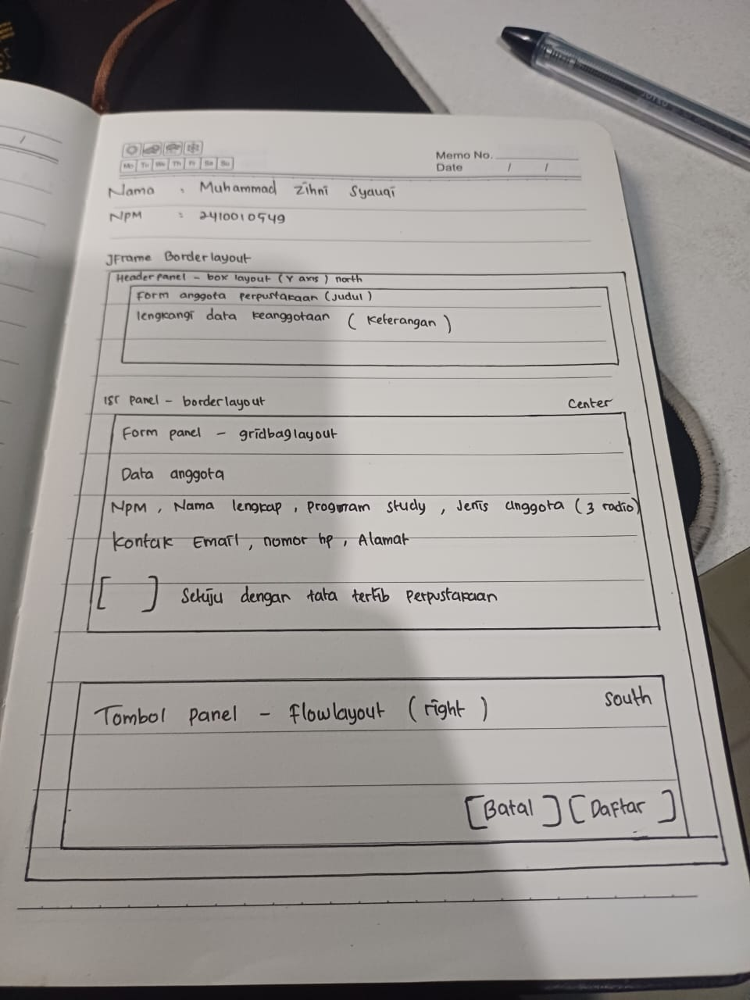
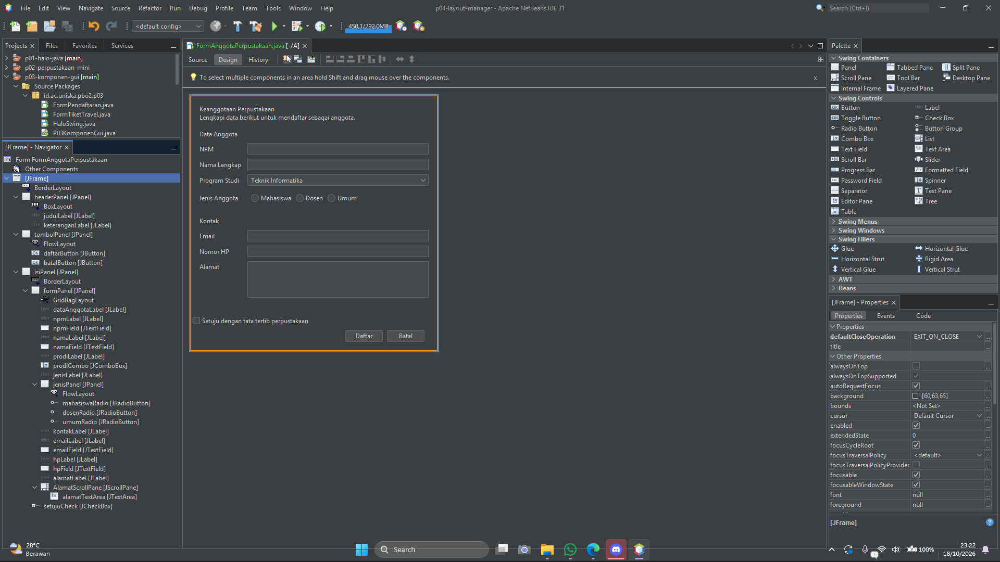

# P04 --- Layout Manager dan Desain Form

## Identitas Mahasiswa

-   **Nama:** Dian Satya Permana
-   **NPM:** 2410010365
-   **Program Studi:** Teknik Informatika
-   **Mata Kuliah:** Pemrograman Berbasis Objek 2 (PBO 2)
-   **Repository:** `pbo2-2410010365`
-   **Folder proyek:** `p04-layout-manager`

## Deskripsi

Proyek ini dibuat untuk memenuhi Praktikum PBO 2 Pertemuan 4 tentang
**Layout Manager dan Desain Form** menggunakan Java Swing di Apache
NetBeans. Praktikum ini membahas penggunaan layout manager untuk
mengatur posisi dan ukuran komponen serta penerapan layout bersarang
pada form.

## Tujuan Praktikum

1.  Memahami perilaku beberapa layout manager pada Java Swing.
2.  Mengatur layout panel melalui menu **Set Layout** di NetBeans.
3.  Menyusun panel dengan layout manager yang berbeda.
4.  Membuat form yang rapi dan menyesuaikan ukuran jendela.
5.  Menerapkan prinsip desain antarmuka seperti keselarasan, kedekatan,
    dan konsistensi.

## Tabel Rancangan Form Anggota Perpustakaan

  Bagian           Panel/Komponen   Layout
  ---------------- ---------------- ----------------------
  Jendela utama    `JFrame`         `BorderLayout`
  Header           `headerPanel`    `BoxLayout (Y_AXIS)`
  Pembungkus isi   `isiPanel`       `BorderLayout`
  Form isian       `formPanel`      `GridBagLayout`
  Tombol           `tombolPanel`    `FlowLayout (RIGHT)`

Jendela utama menggunakan `BorderLayout`. Header ditempatkan di bagian
atas (`NORTH`), isi form di bagian tengah (`CENTER`), dan panel tombol
di bagian bawah (`SOUTH`). `formPanel` ditempatkan pada bagian `NORTH`
dari `isiPanel` agar form tetap berada di atas saat jendela ditinggikan.

## Komponen Form Anggota Perpustakaan

### Data Anggota

-   NPM
-   Nama lengkap
-   Program studi
-   Jenis anggota: Mahasiswa, Dosen, dan Umum

### Kontak

-   Email
-   Nomor HP
-   Alamat

### Persetujuan

-   Checkbox persetujuan tata tertib perpustakaan

### Tombol

-   Batal
-   Daftar

Tombol **Daftar** ditetapkan sebagai tombol default. Aksi tombol belum
dibuat karena event handling dibahas pada pertemuan berikutnya.

## Foto Sketsa dan Tabel Rancangan

### Sketsa Form

Tabel rancangan layout terdapat pada bagian **Tabel Rancangan Form
Anggota Perpustakaan** di atas.

## Screenshot Form Saat Dijalankan

### Ukuran Awal

### Ukuran Saat Jendela Dilebarkan

### Tab Design dan Navigator

## Jawaban Eksperimen Praktikum 2 --- Galeri Layout Manager

### 1. Apa yang berubah ketika FlowLayout diubah menjadi Center lalu jendela diperkecil? Baris apa di `initComponents()` yang berubah?

Komponen pada panel FlowLayout menjadi rata tengah. Ketika lebar jendela
diperkecil dan komponen tidak muat dalam satu baris, komponen dapat
berpindah ke baris berikutnya. Pengaturan yang berubah adalah nilai
alignment pada `FlowLayout`, dari rata kiri menjadi `FlowLayout.CENTER`.

### 2. Jika `gridPanel` diatur dengan Rows = 0 dan Columns = 2, berapa baris yang terbentuk dan mengapa?

Jika terdapat 9 tombol, akan terbentuk 5 baris dengan 2 kolom. Baris
terakhir hanya berisi satu tombol. Rows = 0 membuat jumlah baris
ditentukan otomatis berdasarkan jumlah komponen dan jumlah kolom.

### 3. Apa yang terjadi saat `maximumSize` tombol diatur dengan lebar 32767 dan tinggi sebesar tinggi tombol? Apa fungsi Vertical Strut?

Tombol dapat menggunakan ruang horizontal yang tersedia hingga batas
maksimumnya, sementara tingginya tetap mengikuti tinggi yang ditentukan.
Vertical Strut memberi jarak vertikal di antara komponen agar susunan
tombol tidak terlalu rapat.

## Jawaban Eksperimen Praktikum 4 --- Form Biodata

### 1. Apa yang terjadi jika `weightx` pada `namaField` diubah menjadi 0.0 lalu jendela dilebarkan?

Kolom nama tidak memperoleh bagian tambahan dari ruang horizontal.
Karena itu, kolom isian tidak melebar mengikuti perubahan ukuran jendela
seperti ketika `weightx` diberi nilai lebih besar.

### 2. Apa perbedaan saat `formPanel` di dalam `isiPanel` dipindahkan dari `North` ke `Center`, lalu jendela ditinggikan?

Jika ditempatkan di `North`, form tetap berada di bagian atas. Jika
ditempatkan di `Center`, form berada di tengah ruang yang tersedia
sehingga ruang kosong terbagi di sekelilingnya.

### 3. Apa yang terjadi jika `setMinimumSize(getSize())` dihapus lalu jendela diperkecil?

Jendela dapat diperkecil lebih jauh dari ukuran yang dirancang. Kolom
isian dan komponen lain bisa menjadi terlalu sempit, teks dapat
terpotong, dan tombol menjadi sulit dilihat atau digunakan.

## Pemeriksaan Form oleh Teman --- Tahap 4

-   **Nama teman:** Daffa Masyu Abas
-   **NPM teman:** 2410010481

  ------------------------------------------------------------------------
                           No. Butir pemeriksaan     Hasil
  ---------------------------- --------------------- ---------------------
                             1 Label singkat, jelas, Ya
                               dan sejajar dengan    
                               komponen isian        

                             2 Isian yang berkaitan  Ya
                               dikelompokkan dengan  
                               judul bagian          

                             3 Placeholder digunakan Ya
                               untuk isian yang      
                               memerlukan contoh     
                               format                

                             4 Jenis komponen sesuai Ya
                               dengan data yang      
                               dimasukkan            

                             5 Tombol utama terlihat Ya
                               jelas dan berada di   
                               kanan bawah           

                             6 Jarak antar komponen  Ya
                               terlihat konsisten    

                             7 Form tetap rapi saat  Ya
                               jendela dilebarkan    
                               dan ditinggikan       

                             8 Form dibuat           Ya
                               menggunakan JFrame    
                               Form dan layout       
                               manager, bukan Null   
                               Layout/Absolute       
                               Layout                
  ------------------------------------------------------------------------

### Saran dari Teman

1.  Font pada label header dibuat **bold** dengan ukuran **14** agar
    judul lebih jelas.
2.  `JTextField` NPM diberi placeholder, misalnya **`24100000..`**, agar
    pengguna mengetahui contoh format NPM.

## Jawaban Pertanyaan Refleksi --- Bagian G

### 1. Mengapa Null Layout dan Absolute Layout sebaiknya dihindari?

Karena posisi dan ukuran komponen diatur secara manual. Akibatnya,
tampilan tidak menyesuaikan ukuran jendela dengan baik dan teks atau
komponen dapat terpotong pada ukuran layar berbeda.

### 2. Jelaskan perbedaan perilaku FlowLayout dan GridLayout saat jendela dilebarkan.

`FlowLayout` menyusun komponen berderet dan dapat memindahkan komponen
ke baris berikutnya ketika ruang tidak cukup. `GridLayout` membagi ruang
menjadi sel dengan ukuran sama; ukuran sel menyesuaikan ukuran panel.

### 3. Apa fungsi `weightx` dan `fill` pada `GridBagConstraints`?

`weightx` mengatur pembagian ruang tambahan secara horizontal. Nilai
`1.0` pada kolom isian memungkinkan kolom tersebut menerima ruang
tambahan. `fill = HORIZONTAL` membuat komponen memenuhi lebar selnya.

### 4. Mengapa `formPanel` dibungkus `isiPanel` dan diletakkan di `North`?

Agar form tetap berada di bagian atas saat jendela ditinggikan,
sedangkan ruang kosong tambahan berada di bawah form.

### 5. Sebutkan dua prinsip desain yang diterapkan beserta buktinya.

-   **Keselarasan:** Label dan kolom isian disusun sejajar sehingga
    mudah dibaca.
-   **Kedekatan:** Isian yang saling berkaitan dikelompokkan di bawah
    judul bagian, seperti Data Anggota dan Kontak.

## Deklarasi Penggunaan AI

Saya menggunakan **ChatGPT** sebagai alat bantu untuk memahami materi
layout manager, menyusun draf dokumentasi README, serta membantu
merapikan jawaban eksperimen dan refleksi berdasarkan modul praktikum.
Implementasi program, screenshot, dan hasil akhir diperiksa serta
disesuaikan dengan pekerjaan praktikum.

## Referensi

1.  Modul Praktikum Pemrograman Berbasis Objek 2, Pertemuan 4: *Layout
    Manager dan Desain Form*.
2.  Oracle, *A Visual Guide to Layout Managers*:
    https://docs.oracle.com/javase/tutorial/uiswing/layout/
3.  Oracle, *How to Use GridBagLayout*:
    https://docs.oracle.com/javase/tutorial/uiswing/layout/gridbag.html
4.  Apache NetBeans: https://netbeans.apache.org/
