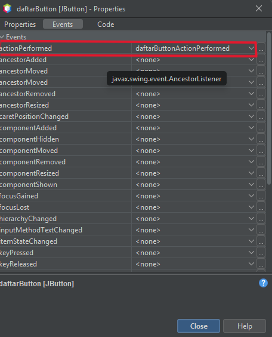
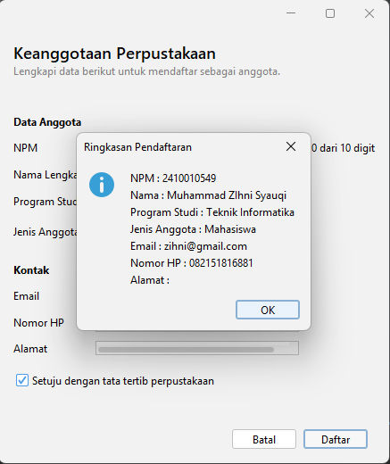
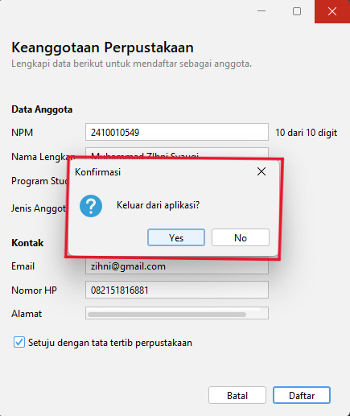

# P05 Event Handling

**Mata Kuliah:** Pemrograman Berbasis Objek 2 (TIF1508)
**Pertemuan:** 5 - Event Handling
**NPM:** 2410010549
**Nama:** Muhammad Zihni Syauqi

Proyek Maven `p05-event-handling` (package `id.ac.uniska.pbo2.p05`) berisi:

| Berkas | Keterangan |
|---|---|
| `PengamatEvent` | Praktikum 2: mengamati event |
| `KonverterSuhu` | Praktikum 3: kelas logika konversi (tanpa GUI) |
| `KonversiSuhu` | Praktikum 3: form konversi suhu |
| `KalkulatorSederhana` | Praktikum 4: kalkulator dengan tiga cara menghubungkan event |
| `FormAnggotaPerpustakaan` | Latihan mandiri: form dari Pertemuan 4 yang sudah memiliki event |

Semua form dibuat dengan **JFrame Form** sehingga tersedia file `.java` dan `.form`.

---

## 1. Tabel Pengamatan Praktikum 2

Hasil dari aplikasi `PengamatEvent`.

| No | Tindakan | Event yang tercatat |
|---|---|---|
| 1 | Arahkan kursor ke tombol, lalu jauhkan | `MouseEvent` kursor masuk ke tombol (`mouseEntered`), lalu `MouseEvent` kursor keluar dari tombol (`mouseExited`) |
| 2 | Klik tombol Klik saya | `MouseEvent` kursor masuk ke tombol (saat kursor tiba), `ActionEvent` tombol diklik (`actionPerformed`), dan `MouseEvent` kursor keluar dari tombol saat kursor dijauhkan |
| 3 | Centang lalu hapus centang Aktifkan fitur | Dua `ItemEvent`: kotak dicentang, lalu centang dihapus (`itemStateChanged`) |
| 4 | Ganti pilihan dari Pagi menjadi Malam | Satu `ItemEvent`: memilih Malam. Event DESELECTED untuk Pagi tidak dicatat karena handler memeriksa `ItemEvent.SELECTED` |
| 5 | Klik isian, lalu ketik kata "abc" | `FocusEvent` isian mendapat fokus (`focusGained`), lalu tiga `KeyEvent`: mengetik huruf a, b, dan c (`keyTyped`) |
| 6 | Klik tombol setelah mengetik di isian | `MouseEvent` kursor masuk ke tombol, `FocusEvent` isian kehilangan fokus (`focusLost`), lalu `ActionEvent` tombol diklik |

---

## 2. Jawaban Eksperimen Praktikum 3 (Konversi Suhu)

**Eksperimen 1: Menghapus pemeriksaan `ItemEvent.SELECTED`**
Pesan `item berubah` tercetak **2 kali** setiap pilihan diganti. `itemStateChanged` pada Combo Box dipanggil sekali untuk pilihan lama (`DESELECTED`) dan sekali untuk pilihan baru (`SELECTED`). Pemeriksaan `evt.getStateChange() == ItemEvent.SELECTED` membuat aksi hanya berjalan sekali.

**Eksperimen 2: Memakai `keyPressed` sebagai pengganti `keyReleased`**
Hasil terlambat satu karakter karena `keyPressed` dipicu **saat tombol ditekan, sebelum karakter dimasukkan** ke dalam isian. Ketika `konversi()` memanggil `getText()`, teks yang terbaca belum memuat karakter terbaru. `keyReleased` dipicu saat tombol dilepas, ketika karakter sudah masuk ke isian, sehingga hasilnya selalu sesuai teks terkini.

**Eksperimen 3: Menghapus blok `try` dan `catch`**
Saat huruf diketik (misalnya `a`), `Double.parseDouble` melempar `NumberFormatException`. Jendela Output menampilkan pesan `Exception in thread "AWT-EventQueue-0" java.lang.NumberFormatException: For input string: "a"` beserta stack trace. Program tidak langsung tertutup, tetapi label hasil tidak diperbarui dan pengguna tidak mendapat umpan balik. Blok `try`-`catch` menangkap kesalahan itu dan menampilkan pesan "Masukkan angka yang valid".

---

## 3. Jawaban Eksperimen Praktikum 4 (Kalkulator Sederhana)

**Eksperimen 1: Event `kaliButton` lewat Events dan lambda sekaligus**
Pesan `kali` tercetak **2 kali** setiap tombol diklik, karena dua listener terdaftar pada tombol yang sama (satu dari `initComponents()`, satu dari lambda di konstruktor) dan keduanya dijalankan. Satu tombol sebaiknya memakai satu cara agar aksi tidak berjalan ganda, yang bisa membuat perhitungan, dialog, atau perubahan data terjadi dua kali dan menyulitkan penelusuran kesalahan.

**Eksperimen 2: Menambahkan tombol `%` (sisa bagi)**
- *Tab Design:* tambahkan Button pada `operatorPanel` dengan nama variabel `modulusButton` dan text `%`; ubah Grid Layout `operatorPanel` dari 4 kolom menjadi 5 kolom; buat event `actionPerformed` melalui Events.
- *Tab Source:* isi `modulusButtonActionPerformed` dengan `hitung('%');`; pada method `hitung` tambahkan `case '%' -> a % b;` di `switch` (jika tidak, operator `%` jatuh ke `default` dan dihitung sebagai pembagian); perluas pemeriksaan pembagi nol menjadi `if ((operator == '/' || operator == '%') && b == 0)`.

**Eksperimen 3: Kursor langsung berada di isian pertama setelah Hapus**
Karena method `hapus` diakhiri `angka1Field.requestFocusInWindow();`, yang memindahkan fokus keyboard ke isian pertama, sehingga pengguna bisa langsung mengetik angka baru.

---

## 4. Peta Event FormAnggotaPerpustakaan

| Komponen | Menu Events | Method | Aksi |
|---|---|---|---|
| `setujuCheck` (kotak centang) | Item: `itemStateChanged` | `setujuCheckItemStateChanged` | Tombol Daftar hanya aktif jika dicentang |
| `batalButton` | Action: `actionPerformed` | `batalButtonActionPerformed` | Mengosongkan semua isian dan mengembalikan fokus ke NPM |
| `daftarButton` | Action: `actionPerformed` | `daftarButtonActionPerformed` | Menampilkan ringkasan data dengan `JOptionPane` |
| `npmField` | Key: `keyReleased` | `npmFieldKeyReleased` | Memperbarui label jumlah digit, misalnya "8 dari 10 digit" |
| Form (`JFrame`) | Window: `windowClosing` | `formWindowClosing` | Meminta konfirmasi sebelum aplikasi ditutup |

Pengaturan tambahan melalui Properties:
- `defaultCloseOperation` form = `DO_NOTHING`, agar jendela hanya tertutup lewat `dispose()` ketika pengguna memilih Yes.
- Properti `enabled` pada `daftarButton` tidak dicentang (tombol nonaktif sampai persetujuan dicentang).

Logika yang dipakai ulang ditulis sekali sebagai method bantu:
- `perbaruiJumlahDigit()` dipanggil dari konstruktor, `npmFieldKeyReleased`, dan `kosongkanIsian()`.
- `kosongkanIsian()` dipanggil dari `batalButtonActionPerformed`.

---

## 5. Tangkapan Layar

### Properties bagian Events untuk tombol Daftar

### Dialog ringkasan pendaftaran

### Dialog konfirmasi keluar

---

## 6. Jawaban Pertanyaan Refleksi

1. **Sumber event, object event, dan listener.**
   Pada `daftarButton`, *sumber event* adalah tombol Daftar yang diklik. *Object event* adalah `ActionEvent` yang berisi informasi kejadian. *Listener* adalah `ActionListener` yang didaftarkan lewat `addActionListener()` di `initComponents()`, dan method `actionPerformed`-nya memanggil `daftarButtonActionPerformed(evt)`.

2. **KeyListener dan lambda.**
   `KeyListener` memiliki tiga method abstract (`keyPressed`, `keyReleased`, `keyTyped`), sehingga bukan interface fungsional dan tidak bisa ditulis dengan lambda. NetBeans memakai `KeyAdapter` (implementasi kosong semua method) lalu hanya menimpa `keyReleased`, seperti pada `npmField.addKeyListener(new java.awt.event.KeyAdapter() { ... })`.

3. **Keuntungan memisahkan `KonverterSuhu` dari form.**
   Logika bisa dipakai ulang, mudah diuji tanpa GUI, dan lebih mudah dipelihara karena tampilan dan perhitungan tidak tercampur.

4. **Pemeriksaan `ItemEvent.SELECTED`.**
   `itemStateChanged` dipanggil dua kali pada Combo Box (DESELECTED untuk pilihan lama, SELECTED untuk pilihan baru). Tanpa pemeriksaan, aksi berjalan dua kali.

5. **Kapan memakai setiap cara.**
   *Event handler GUI Builder* sebagai cara utama pada JFrame Form karena tersimpan di file `.form` dan mudah dilacak. *Lambda* untuk aksi singkat yang ditulis di konstruktor setelah `initComponents()`. *Method reference* ketika aksinya sudah berupa method tersendiri dengan parameter yang cocok.

---

## 7. Deklarasi Penggunaan AI

Saya menggunakan **ChatGPT** untuk:
- memandu langkah penyusunan form dan pembuatan event di GUI Builder (termasuk pengaturan `GridBagLayout` untuk label jumlah digit);
- membantu menelusuri error `NullPointerException` akibat urutan `perbaruiJumlahDigit()` dan `initComponents()` di konstruktor;
- membantu menyusun draf README ini.

Kode dijalankan dan diuji sendiri, dan saya memahami isi setiap event handler.
