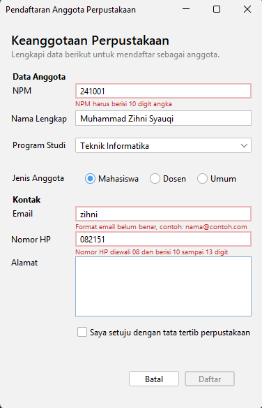
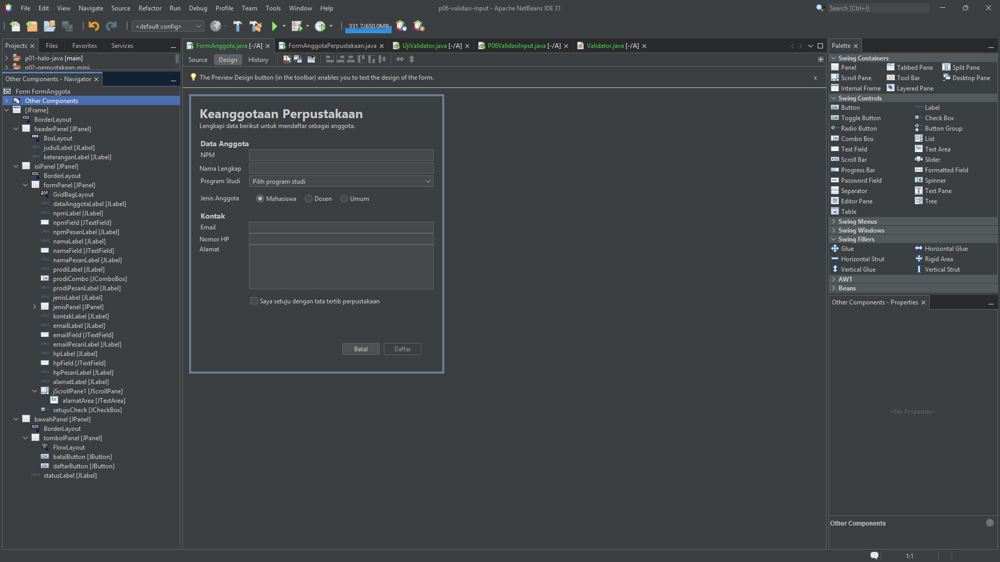
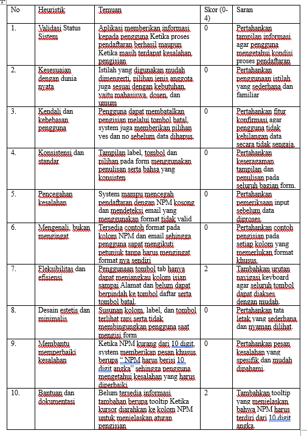

# P06 – Validasi Input dan Kegunaan

## 1. Identitas Proyek

- **Mata Kuliah:** Pemrograman Berbasis Objek 2
- **Modul:** Pertemuan 6 – Validasi Input dan Kegunaan
- **Nama:** Muhammad Zihni Syauqi
- **NPM:** 2410010549
- **Nama Proyek:** `p06-validasi-input`
- **Repository:** `pbo2-2410010549`
- **Form:** `FormAnggotaPerpustakaan`

## 2. Screenshot Hasil Praktikum

### 2.1 Form dengan Pesan Kesalahan

### 2.2 Navigator dengan Label Pesan

## 3. Hasil Peer Review

Peer review dilakukan oleh **Dian Satya Permana** terhadap form milik **Muhammad Zihni Syauqi**.

## 4. Temuan, Perbaikan, dan Commit

| No. | Temuan Peer Review | Perbaikan yang Dilakukan | Commit |
|---|---|---|---|
| 1 | Navigasi Tab belum mencapai tombol Batal dan Daftar. | Mengatur ulang urutan komponen melalui Navigator. | Isi hash commit |
| 2 | Belum tersedia tooltip pada kolom NPM. | Menambahkan tooltip pada `npmField` berisi petunjuk format NPM. | Isi hash commit |

## 5. Jawaban Eksperimen Praktikum 4

### 1. Ketik huruf pada isian NPM. Apa yang terjadi dan baris mana di `npmFieldKeyTyped` yang menyebabkannya?

Ketika pengguna mengetik huruf pada kolom NPM, karakter tersebut tidak akan dimasukkan. Program memeriksa karakter menggunakan `Character.isDigit(evt.getKeyChar())`. Jika karakter bukan angka atau jumlah digit sudah mencapai 10, program menjalankan `evt.consume()` sehingga karakter dibatalkan.

### 2. Isi email dengan `siti@`, lalu tekan Tab. Kapan pesan kesalahan muncul?

Pesan kesalahan muncul ketika pengguna meninggalkan kolom Email atau saat event `focusLost` dijalankan. Program memeriksa format email melalui method `periksaEmail()`. Jika format tidak sesuai, pesan "Format email belum benar, contoh: nama@contoh.com" akan ditampilkan.

### 3. Klik isian Nama tanpa mengetik, lalu tekan Tab. Mengapa tidak ada pesan kesalahan?

Karena pemeriksaan pada event `focusLost` hanya dilakukan apabila kolom Nama tidak kosong. Pemeriksaan isian kosong dilakukan ketika tombol Daftar diklik agar pengguna tidak langsung mendapat pesan kesalahan ketika baru melewati kolom.

### 4. Centang persetujuan, lalu klik Daftar dengan form kosong. Isian mana yang mendapat fokus?

Fokus diarahkan ke kolom NPM sebagai isian pertama yang mengalami kesalahan. Program memeriksa semua isian dan menyimpan komponen yang tidak valid ke dalam daftar `salah`. Kemudian `salah.get(0).requestFocusInWindow()` mengarahkan fokus ke kesalahan pertama.

### 5. Tekan tombol Alt bersama huruf N. Isian mana yang mendapat fokus, dan properti apa yang mengaturnya?

Fokus berpindah ke kolom Nama apabila mnemonic huruf N sudah dipasang pada label Nama dan label tersebut terhubung dengan kolom Nama. Properti yang mengaturnya adalah `displayedMnemonic` dan `labelFor`.

### 6. Isi beberapa isian, lalu klik Batal dan pilih No. Apakah data tetap ada?

Ya, data yang sudah dimasukkan tetap ada. Ketika pengguna memilih No pada dialog konfirmasi, method `batal()` menjalankan `return` sehingga proses pengosongan form dihentikan.

Contoh tooltip: "NPM harus terdiri dari 10 digit angka."

## 6. Jawaban Pertanyaan Refleksi Modul (Bagian H)

### 1. Mengapa aturan validasi dipisahkan ke kelas Validator, bukan ditulis langsung di event handler?

Aturan validasi dipisahkan ke kelas Validator agar kode lebih terstruktur dan mudah dikelola. Event handler menangani interaksi pengguna, sedangkan Validator memeriksa kebenaran data. Aturan validasi juga lebih mudah diuji tanpa menjalankan GUI.

### 2. Mengapa isian kosong tidak langsung ditandai merah saat pengguna hanya melewatinya?

Karena pengguna mungkin belum sempat mengisi kolom tersebut. Jika kolom kosong langsung ditandai merah, pengguna dapat merasa terganggu. Oleh karena itu, pemeriksaan isian kosong dilakukan ketika tombol Daftar diklik.

### 3. Sebutkan tiga heuristik Nielsen yang diterapkan pada form Anda beserta buktinya.

- **Pencegahan Kesalahan:** Kolom NPM hanya menerima angka dan dibatasi maksimal 10 digit.
- **Membantu Memperbaiki Kesalahan:** Sistem menampilkan pesan kesalahan di bawah kolom yang tidak valid.
- **Kendali dan Kebebasan Pengguna:** Tombol Batal menampilkan konfirmasi sebelum data dihapus.

### 4. Mengapa pesan kesalahan tidak boleh hanya berupa warna merah?

Karena tidak semua pengguna dapat membedakan warna dengan mudah. Pesan kesalahan harus disertai tulisan yang menjelaskan bagian yang salah dan cara memperbaikinya agar dapat dipahami oleh semua pengguna.

### 5. Temuan peer review mana yang paling bermanfaat bagi Anda dan mengapa?

Temuan yang paling bermanfaat adalah masalah navigasi menggunakan tombol Tab dan belum adanya tooltip pada kolom NPM. Temuan tersebut menunjukkan bahwa form tidak hanya perlu memiliki validasi yang benar, tetapi juga harus mudah digunakan dan memberikan petunjuk kepada pengguna.

## 7. Deklarasi Penggunaan AI

Dalam pengerjaan tugas Modul 6 ini, saya menggunakan **ChatGPT** sebagai alat bantu untuk:

1. Membantu memahami materi validasi input dan kegunaan.
2. Membantu memahami dan menyusun jawaban eksperimen Praktikum 4.
3. Membantu menyusun refleksi berdasarkan heuristik Nielsen.
4. Membantu menyusun dokumentasi proyek dalam file README.md.

Penggunaan AI hanya sebagai alat bantu pembelajaran dan penyusunan dokumentasi. Implementasi, pengujian, dan penyesuaian program dilakukan pada proyek praktikum.